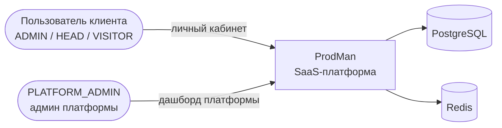
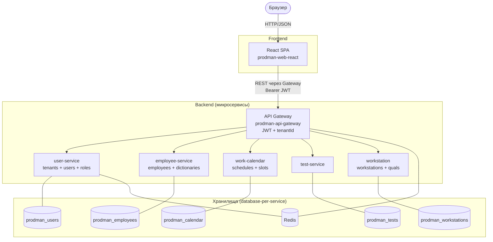
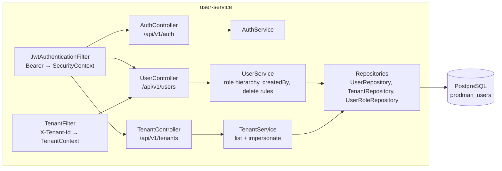
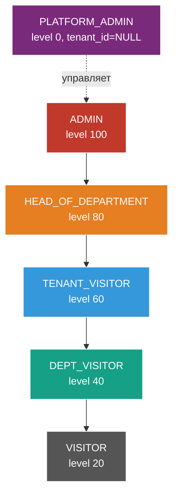
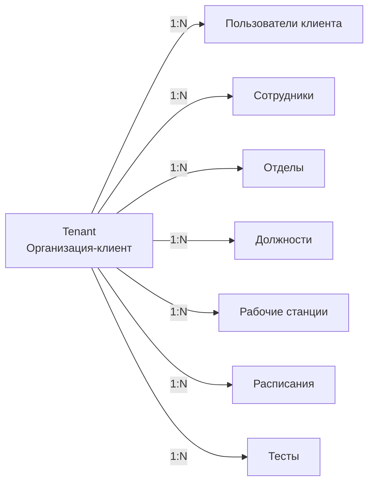
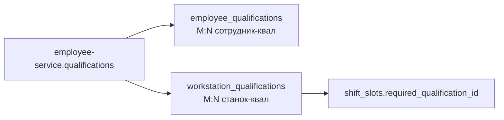

# Архитектура ProdMan

ProdMan — SaaS-приложение: каждая организация-клиент работает в изолированном личном кабинете. Все бизнес-данные принадлежат клиенту и разделяются по `tenant_id`. Отдельно — `PLATFORM_ADMIN` (вне тенантов), который управляет клиентами платформы.

## Уровень 1. Контекст (C4 Context)



## Уровень 2. Контейнеры (C4 Container)



**Ключевое:** Gateway извлекает `tenantId` из JWT и прокидывает `X-Tenant-Id` во внутренние сервисы. `PLATFORM_ADMIN` не имеет `tenantId`, поэтому его запросы идут без `X-Tenant-Id`, а `/api/v1/tenants/**` разрешён только ему.

## Уровень 3. Компоненты user-service



## Роли и иерархия



**Правило назначения:** `target.level() <= current.level()`. `PLATFORM_ADMIN` назначать нельзя. Удаление/отзыв — `target.level() < current.level()`.

## Модель мультитенантности



Правила:
- У каждой бизнес-сущности — `tenant_id`.
- `tenant_id` приходит **только из JWT** (через `X-Tenant-Id` от Gateway) или из `TenantContext` в user-service.
- Уникальность — составная: `(tenant_id, code)`.
- Пользователь видит только данные своего тенанта.

Подробнее — [ADR-0002](./adr/0002-multi-tenancy.md).

## Квалификации: станок ↔ сотрудник



Поток:
1. `shift_slot` хранит `required_qualification_id` (одну из квалификаций станка) или `null`.
2. При `assign` `work-calendar` сверяет `employee_qualifications_ref` (локальный кэш).
3. Не совпало → **409 QUALIFICATION_MISMATCH** + модалка override.
4. Override → `qualification_overridden = true`, `qualification_override_reason` сохраняется.
5. Визуально: слот и день оранжевые (`qualificationMismatch = true`) — независимо от override.

Синк `employee_qualifications_ref`: при каждом `assign` + `POST /api/sync/all`.

## Потоки аутентификации

### Логин тенантного пользователя
1. `POST /api/v1/auth/login` с `{ slug, username, password }`.
2. `AuthService` ищет `(tenant, username)`, проверяет пароль, статус тенанта.
3. Собирает `activeRoles` = основная + временные (активные на сейчас).
4. `JwtService.generateToken` → access (24ч) + refresh (7д).
5. `AuthResponse` содержит `role` (основная), `tenantId`, `tenantSlug`, `tenantStatus`, `tenantPlan`, `departmentId`.

### Логин PLATFORM_ADMIN
1. `POST /api/v1/auth/login` с `{ username, password }` (без slug).
2. `findByTenantIdIsNullAndUsername` → `PLATFORM_ADMIN`.
3. Токен без `tenantId`, без `tenantStatus`. `AuthResponse` с пустыми `tenantId`/`tenantSlug`.

### Имперсонация (план)
1. `PLATFORM_ADMIN` открывает `/platform-dashboard`, видит список тенантов.
2. `POST /api/v1/tenants/{id}/impersonate` → `AuthResponse` с `role=ADMIN`, `tenantId=<id>`, `tenantSlug`, `tenantStatus`, `tenantPlan`.
3. Фронт: `localStorage.accessToken = новый`, `localStorage.platformAccessToken = старый`.
4. Меню тенанта. «Выйти из тенанта» → восстановить `platformAccessToken`.

## Основные потоки

### Расстановка сотрудников
1. SPA запрашивает сотрудников (`employee-service`) и станции (`workstation`) — только своего тенанта.
2. Менеджер назначает через `POST /work-calendar/api/shift-slots/{id}/assign`.
3. `work-calendar` проверяет квалификацию + занятость, сохраняет слот.
4. Отчёты: `GET /work-calendar/api/reports/hours/by-employee`, `/schedule`.

## Принципы

- Database-per-service.
- Мультитенантность: shared schema + `tenant_id` (ADR-0002).
- REST-общение, синхронно.
- JWT — единственный источник идентичности и `tenantId`.
- Liquibase — все изменения схемы.
- Фронт не знает внутренних адресов — только Gateway (или Vite proxy в dev).

## Связанные документы

- [ADR](./adr/)
- [PROJECT.md](../PROJECT.md)
- [README.md](../README.md)
```
